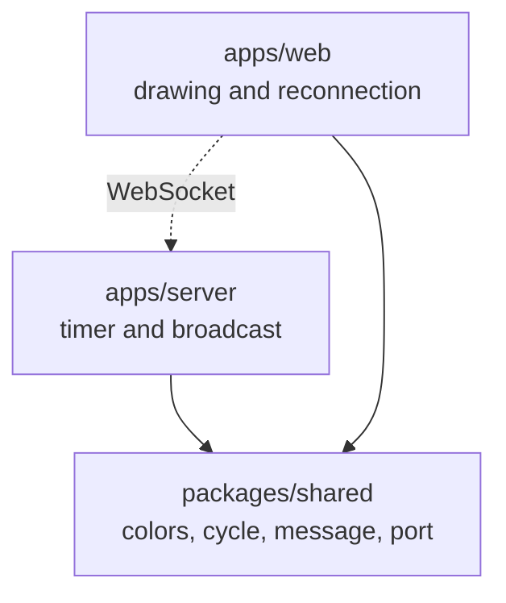
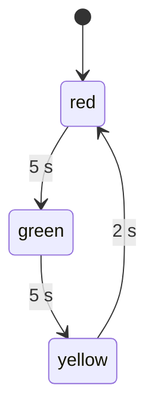
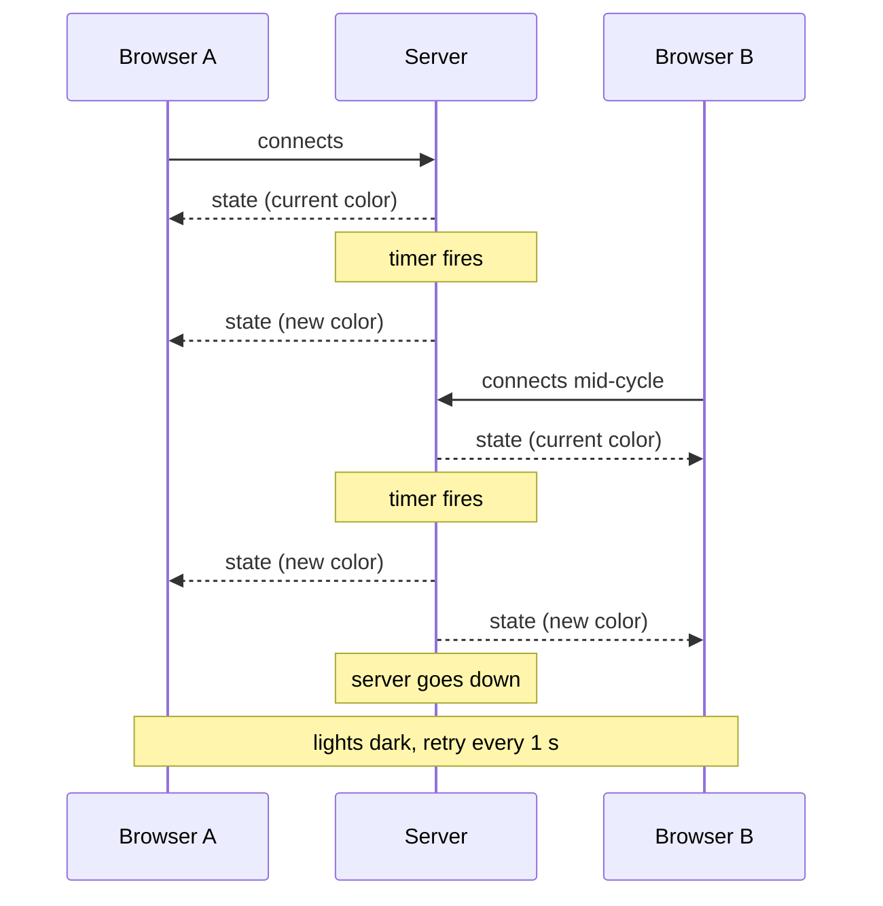

# WebSocket Traffic Light - Plan

## Goal Capsule

- **Objective:** Anyone who opens the page sees a traffic light whose color matches, at every moment, the one every other connected browser sees.
- **Means:** A pnpm monorepo with a Node server that owns the state and sends it over WebSocket to a framework-free page (KTD1, KTD2, KTD4).
- **Authority:** R-IDs govern product behavior. KTDs govern the mechanism. A unit overrides neither.
- **Execution profile:** New, low-risk work in a repository with no commits and no remote. It ships as a single change set; if a remote is added later, it goes in one PR.
- **Stop conditions:** Stop and ask if meeting a requirement needs authentication, persistence, or a runtime dependency other than `ws`.
- **Who finishes:** The executor implements and verifies. The user decides when to commit; today there are staged files and no initial commit.

---

## Product Contract

### Summary

A traffic light that changes by itself, on fixed timings set by a server, and stays in sync across every browser connected over WebSocket. The code lives in a monorepo with three packages: the server, the web page, and a shared package holding the message contract.

### Problem Frame

The repository is a freshly created skeleton: a `package.json`, a `tsconfig.json`, and a `src/index.ts` that only prints a greeting. Its purpose is to try the Compound Engineering workflow on something small but real. A synchronized traffic light is a good case because it forces the questions that set a real-time application apart: a single owner of the state, clients that arrive late, and connections that drop.

### Requirements

**Light cycle**

- R1. The light cycles red, green, yellow and back to red, indefinitely.
- R2. Each color lasts a fixed time: red 5 s, green 5 s, yellow 2 s.
- R3. The cycle advances even when no browser is connected.

**Synchronization**

- R4. Every connected browser shows the same color and changes at the same time.
- R5. A browser that connects mid-cycle shows the current color at once, without waiting for the next change.

**Web page**

- R6. The page draws the three lights in vertical order red, yellow, green, with exactly one lit while connected.
- R7. If the connection is lost, all three lights go dark and the page retries until it reconnects.

**Repository**

- R8. The code is a monorepo where the server and the page share a single definition of the colors and the message.
- R9. One command at the root starts the server and the page for development.

### Scope Boundaries

Not built:

- Manual control of the light from the browser. The browser only listens.
- A countdown or any indication of the time left for each color.
- Several lights or coordinated intersections.
- Authentication, a database, and deployment.

Considered and not built, with the evidence that would change the call:

- **Periodic ping to detect dead connections.** On localhost a closed connection always reaches the other end. This would change if the server sat behind a proxy that drops idle connections.
- **Origin validation on the server.** The only data exposed is a public color, and the server ignores whatever it receives. This would change if the browser could send commands.
- **Latency compensation between clients.** Each client paints when the message arrives, and on a local network the difference cannot be perceived. This would change if the countdown were added.
- **Growing delay between retries.** One retry per second against a local server does no harm. This would change with a server shared by many clients.

---

## Planning Contract

### Key Technical Decisions

- KTD1. **pnpm workspaces with no orchestrator.** `pnpm-workspace.yaml` declares `apps/*` and `packages/*`, and the root scripts use `pnpm -r`. Turborepo or Nx add nothing with three packages and no build step. pnpm 10.26.2 is already installed.
- KTD2. **Node server with `ws`.** It is the only runtime dependency. The server broadcasts by walking `wss.clients` and sending only to those whose `readyState` is open, which is the pattern the library documents ([ws README](https://github.com/websockets/ws/blob/master/README.md)). Bun ships a native WebSocket, but the user confirmed Node.
- KTD3. **The shared package is consumed as TypeScript source, uncompiled.** Its `package.json` points `exports` at `src/index.ts`. `tsx` and Vite read TypeScript directly, so there is no build step and no build order between packages.
- KTD4. **Framework-free page, served by Vite.** Vite acts only as the dev server and the transpiler. The drawing is three elements and one CSS class.
- KTD5. **The server alone keeps time.** It schedules each change with a timer set to the current color's duration and broadcasts the new color when it changes. Clients compute nothing: they paint the last thing they received. This is what enforces R4.
- KTD6. **One message type, from server to client.** It is a JSON object with the type `state` and the color. The server sends it when a client connects (R5) and on every change (R4). The server registers no handler for incoming messages.
- KTD7. **The client validates what it receives.** The function that parses the message lives in the shared package and returns nothing when the text is not valid JSON or the color is not one of the three. The client ignores those messages.
- KTD8. **The WebSocket port is defined once, in the shared package.** The server listens on that port and the page builds the URL from the current host name and the same port. There is no environment variable to change it, because the page could not read it and would end up pointing at the wrong port. No Vite proxy.
- KTD9. **Tests with `node:test` run by `tsx`.** No test framework is added. The server is exposed as a function that takes a port and durations and returns a way to close it, so tests use a free port and millisecond durations.
- KTD10. **ESM and strict TypeScript in every package.** A `tsconfig.base.json` at the root replaces the current `tsconfig.json`, which is CommonJS and points at a `src/` that goes away.

### High-Level Technical Design

Package dependencies:



Light cycle (R1, R2):



Protocol between server and browsers (R4, R5, R7):



### Output Structure

```text
pnpm-workspace.yaml
package.json
tsconfig.base.json
packages/shared/
  package.json
  tsconfig.json
  src/index.ts
  src/index.test.ts
apps/server/
  package.json
  tsconfig.json
  src/server.ts
  src/main.ts
  src/server.test.ts
apps/web/
  package.json
  tsconfig.json
  index.html
  src/main.ts
  src/style.css
```

---

## Implementation Units

### U1. Monorepo structure

- **Goal:** Leave the root as an empty but installable pnpm workspace with shared TypeScript configuration.
- **Requirements:** R8, R9
- **Dependencies:** none
- **Files:**
  - create `pnpm-workspace.yaml`
  - create `tsconfig.base.json`
  - modify `package.json`
  - modify `.gitignore`
  - delete `tsconfig.json`
  - delete `src/index.ts`
  - delete `package-lock.json`
- **Approach:**
  1. Remove the `node_modules` and `package-lock.json` left by an earlier npm install, before the first pnpm install. Neither is tracked.
  2. Declare `apps/*` and `packages/*` as workspaces (KTD1).
  3. Replace the root `build` script with `dev`, `test` and `typecheck`, each delegating to every package. `dev` runs them in parallel.
  4. Move the strict configuration to `tsconfig.base.json` with ESM modules and no emit (KTD10).
  5. In `.gitignore`, change `/node_modules` to `node_modules`, because the current form covers only the root and would leave each package's folder unignored. Add `dist` and `.DS_Store`.
  6. `.DS_Store` is currently staged. Removing it from the index is a git action for the user to decide; the executor flags it and does not do it on its own.
- **Execution note:** This is configuration and packaging. The proof is that the install finishes without errors, not unit coverage.
- **Test scenarios:** Test expectation: none -- configuration only, no behavior.
- **Verification:** `pnpm install` finishes with no errors and no workspace warnings. `git status` lists no `node_modules`.

### U2. Shared package: cycle and message contract

- **Goal:** Define the colors, the cycle order, the durations, the message and the port in one place.
- **Requirements:** R1, R2, R8
- **Dependencies:** U1
- **Files:**
  - create `packages/shared/package.json`
  - create `packages/shared/tsconfig.json`
  - create `packages/shared/src/index.ts`
  - create `packages/shared/src/index.test.ts`
- **Approach:** Export the color type, the initial color, the function that gives the next color, the default durations, the message type, the function that serializes it, the function that parses it (KTD7) and the default port (KTD8). Everything is pure functions and constants; the package has no dependencies. `exports` points at the source (KTD3).
- **Test scenarios:** Tests live next to the source. They cover the pure logic of the cycle and the contract; they do not cover timers or the network.
  - Starting from red, asking for the next color three times gives green, yellow and red.
  - The default durations are 5000 ms for red, 5000 ms for green and 2000 ms for yellow.
  - Serializing a green state and parsing the result returns a green state.
  - Parsing text that is not JSON does not throw and returns nothing.
  - Parsing JSON with an unknown color, for example blue, returns nothing.
  - Parsing valid JSON with a different message type returns nothing.
- **Verification:** The package tests pass and the type check reports no errors.

### U3. WebSocket server

- **Goal:** Keep the cycle running and send the color to every browser.
- **Requirements:** R1, R2, R3, R4, R5
- **Dependencies:** U2
- **Files:**
  - create `apps/server/package.json`
  - create `apps/server/tsconfig.json`
  - create `apps/server/src/server.ts`
  - create `apps/server/src/main.ts`
  - create `apps/server/src/server.test.ts`
- **Approach:**
  1. `server.ts` exports a function that takes a port and durations, starts the server and returns the actual port and a way to close it (KTD9).
  2. The timer and the broadcast follow KTD5 and KTD6, with the broadcast pattern from KTD2.
  3. Closing the server cancels the pending timer, so tests finish without hanging processes.
  4. `main.ts` only calls that function with the port from KTD8 and the default durations, and prints the port it listens on.
  5. The `dev` script uses `tsx` watch mode to restart on save.
- **Execution note:** Start with the integration test of the contract: a client connects and receives the current color.
- **Technical design:** Directional guidance, not a specification.
  ```text
  on start:    color = initial; schedule(duration[color])
  on timeout:  color = next(color); broadcast(color); schedule(duration[color])
  on connect:  send(color) to that client only
  on close:    cancel timer; close connections
  ```
- **Test scenarios:** Tests start a real server on a free port with durations of tens of milliseconds and connect with the `ws` client. They cover the whole network contract; they do not cover drawing in the browser.
  - A client connects to a freshly started server and the first message it receives is a red state.
  - A connected client receives, in order, green, yellow and red after the initial state.
  - Two connected clients receive the same sequence of colors.
  - With the server running and no clients, wait longer than the red duration; a client that connects then receives a color other than red as its first message.
  - A client connects and disconnects, and the server keeps broadcasting to a second client without throwing.
  - A client sends arbitrary text to the server and the sequence the clients receive does not change.
  - After the server is closed, the test process exits by itself, with no pending timers.
- **Verification:** The package tests pass. Starting the server by hand prints the port it listens on.

### U4. Web page

- **Goal:** Draw the traffic light and keep it connected to the server.
- **Requirements:** R4, R5, R6, R7, R9
- **Dependencies:** U2, U3
- **Files:**
  - create `apps/web/package.json`
  - create `apps/web/tsconfig.json`
  - create `apps/web/index.html`
  - create `apps/web/src/main.ts`
  - create `apps/web/src/style.css`
- **Approach:**
  1. `index.html` holds the three lights in the order from R6, dark by default.
  2. `main.ts` opens the connection to the URL from KTD8 with the browser's native `WebSocket`.
  3. On a message, it parses it with the shared function (KTD7) and lights only the light of that color.
  4. When the connection closes, it turns all three lights off and tries again one second later, until it connects (R7).
  5. The light exposes its current state as accessible text, so it does not rely on color alone: the color name while connected, and "disconnected" when the lights are dark.
- **Execution note:** Verify in a real browser. No simulated DOM environment is added for three elements.
- **Test scenarios:** These are manual checks in the browser. Message parsing is already covered by the U2 tests; what this level does not cover automatically is drawing and reconnection.
  - With the server and the page running, opening the page shows a single lit light that changes from red to green, to yellow and to red.
  - With two windows side by side, both change color at the same time.
  - Reloading a window partway through a color shows that same color at once, matching the other window.
  - Stopping the server turns all three lights off in every window within two seconds.
  - Starting the server again lights the right light in every window without reloading the page.
  - The browser console shows no errors during a full cycle with the server up.
- **Verification:** All six checks hold and the package type check reports no errors.

---

## Verification Contract

| What it proves | Command | Applies to |
|---|---|---|
| The workspace installs | `pnpm install` | U1 |
| Cycle logic and network contract | `pnpm test` | U2, U3 |
| Types in all three packages | `pnpm typecheck` | U2, U3, U4 |
| Server and page start together | `pnpm dev` | U3, U4 |
| Behavior in the browser | Open the URL Vite prints in two windows and walk through the U4 scenarios | U4 |

U1 creates the `test`, `typecheck` and `dev` scripts. Today the root has only `build`.

---

## Definition of Done

- R1 to R9 hold, and each is covered by an automated test or by a manual U4 scenario.
- `pnpm test` and `pnpm typecheck` pass from the root.
- `pnpm dev` starts the server and the page with one command.
- The only runtime dependency added is `ws`. The development ones are `typescript`, `tsx`, `vite` and the types for `ws` and Node.
- No `src/index.ts`, `tsconfig.json` or `package-lock.json` remains at the root. The only lockfile is `pnpm-lock.yaml`.
- No code from discarded attempts and no temporary test files remain in the diff.
