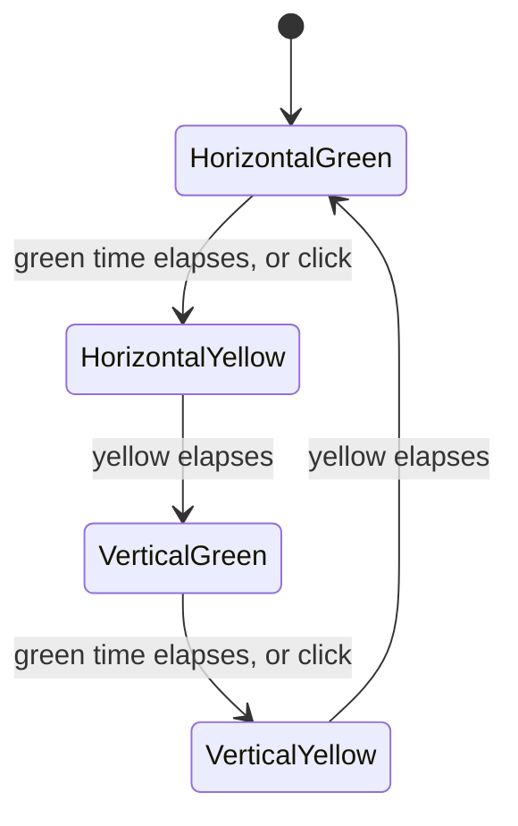
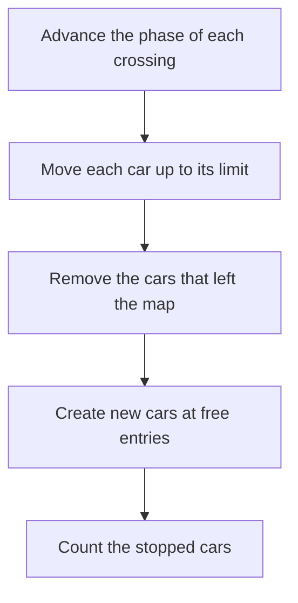
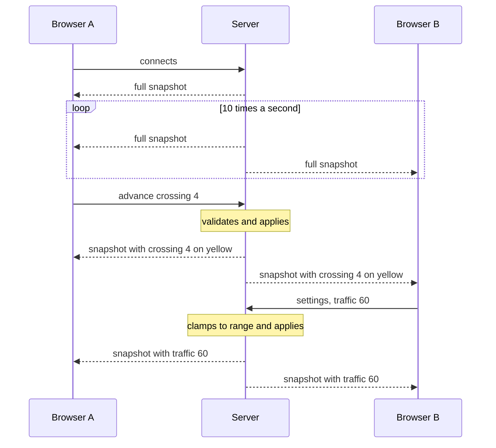

# WebSocket Traffic City - Plan

## Goal Capsule

- **Objective:** Several people, each in their own browser, see the same city with traffic and any of them can act on it; what one person does, everyone else sees at once.
- **Means:** The server runs the simulation and sends everyone a full snapshot of the state several times a second; browsers draw it and send their actions back (KTD1, KTD2).
- **Authority:** R-IDs govern behavior. KTDs govern the mechanism. A unit overrides neither. The earlier plan, `docs/plans/2026-11-12-1837-feat-websocket-traffic-light-plan.md`, stays as history: its single traffic light is replaced and its "the browser only listens" rule no longer holds.
- **Execution profile:** A single, low-risk change set on the `feat/websocket-traffic-light` branch. The repository has no remote, so there is no PR: it ships as local commits.
- **Stop conditions:** Stop if meeting a requirement needs a new runtime dependency, user accounts, or state saved to disk.
- **Who finishes:** The executor implements, verifies and makes the local commits. Publishing the branch is left to the user once a remote exists.
- **Open blockers:** none.

---

## Product Contract

### Summary

A small city on a fixed map, with a traffic light at every crossing, where cars drive, stop at red and queue. There is one city and it runs on the server. Anyone connected can change a light with a click and adjust the amount of traffic and the timings, and every browser sees the change and its effect on traffic at the same time.

### Problem Frame

The current traffic light only pushes a color from the server to the browsers. That shows half of what a WebSocket does: nobody sends anything back, and nothing on screen depends on another person. It does not show what a traffic light is for either, because there is no traffic to regulate.

The demo needs shared state that changes fast, that several people can alter, and where the effect of someone else's action shows up without anyone reloading the page.

### Key Decisions

- **A small city on a fixed map.** (session-settled: user-directed — chosen over a single crossing and over an editable SimCity-style city: enough to see traffic spread out, without building an editor) Governs R1.
- **Everyone can act, with no roles.** (session-settled: user-directed — chosen over a single control screen with everyone else read-only: it is the most interactive option for showing the WebSocket working in both directions) Governs R9, R10, R12.
- **Two ways to act: clicking a light and adjusting controls.** (session-settled: user-directed — chosen over watching only, or only one of the two: same reason as above) Governs R9, R10.
- **Basic queue traffic.** (session-settled: user-directed — chosen over routes with turns and over driving with gradual acceleration: enough to see jams form and clear) Governs R2, R3.
- **Same monorepo and same tools as the current traffic light.** (session-settled: user-approved — chosen over Bun and a UI framework: they already work and are tested in this repository)
- **Top-down view with simple shapes.** Simutrans-style isometric perspective adds nothing to the demonstration. Governs R17.
- **If two people act at once, the last one wins.** No turns and no locks, because the point is to see the other person's action, not to arbitrate it. Governs R11.

### Requirements

**City and traffic**

- R1. The map is fixed: three horizontal and three vertical streets forming nine crossings, all two-way with one lane per direction.
- R2. Cars appear at the ends of the streets, at the edge of the map, drive straight along their lane and leave at the opposite end.
- R3. A car stops before a crossing when its light is not green, and stops behind the car ahead leaving a gap.
- R4. A car does not enter a crossing unless there is room for it to fit completely on the far side.
- R5. How often cars appear follows the shared traffic volume setting.
- R6. The city keeps running even when no browser is connected.

**Traffic lights**

- R7. Each crossing gives the right of way to one of its two streets at a time, and never has both on green or yellow at once.
- R8. With nobody acting, each crossing alternates the right of way by itself: green for the shared green time, then yellow, then the right of way to the other street.

**Interaction**

- R9. Anyone connected can click a crossing to bring its change forward: the street on green goes to yellow at that moment and the crossing then carries on with its automatic cycle.
- R10. Anyone connected can change the traffic volume and the green time, and both settings apply to the whole city.
- R11. When two people change the same thing almost at once, the last change the server receives stands and everyone ends up seeing that value.
- R12. There are no accounts and no password: whoever opens the page can act.

**Synchronization**

- R13. Every browser shows the same city: the same cars in the same positions, the same lights and the same control values.
- R14. One person's action shows up in every browser without reloading the page.
- R15. Whoever connects while the city is running sees its current state at once, including the control values.
- R16. If the connection is lost, the page says so clearly, stops presenting the city as if it were current, and retries until it reconnects.

**Screen**

- R17. The city is drawn top-down with simple shapes and replaces the current single-light page.
- R18. The screen shows how many people are connected.
- R19. The screen shows how many cars are stopped waiting.

Cycle of one crossing (R7, R8, R9):



There is no flows section: the behavior is continuous and is fixed by the requirements and the examples below.

### Acceptance Examples

- AE1. **Covers R3, R7.**
  - **Given:** a crossing with the horizontal street on red and cars arriving along it.
  - **When:** time passes.
  - **Then:** the cars pile up in a line before the crossing, and when the horizontal street gets green they leave in the order they arrived.
- AE2. **Covers R9, R14.**
  - **Given:** two open browsers, A and B, and a crossing with the vertical street on green.
  - **When:** A clicks that crossing.
  - **Then:** A and B see the vertical street go to yellow and then the horizontal street go to green, and the crossing keeps alternating by itself.
- AE3. **Covers R9.**
  - **Given:** a crossing that is on yellow.
  - **When:** someone clicks it.
  - **Then:** nothing changes; the crossing finishes the change already under way.
- AE4. **Covers R10, R14, R15.**
  - **Given:** two open browsers, A and B.
  - **When:** A raises the traffic volume to the maximum.
  - **Then:** B's control moves to the same value, more cars appear in both, and a third browser that connects later sees the control at the maximum.
- AE5. **Covers R4.**
  - **Given:** a queue that fills the block on the far side of a crossing.
  - **When:** the car waiting before the crossing gets green.
  - **Then:** it does not move until there is room, and cars on the cross street keep crossing when it is their turn.
- AE6. **Covers R11.**
  - **Given:** two open browsers, A and B.
  - **When:** A and B set different green times at almost the same moment.
  - **Then:** both end up showing the same value, the one from the last change received.
- AE7. **Covers R18.**
  - **Given:** two open browsers showing "2".
  - **When:** a third one opens and then closes.
  - **Then:** all show "3" and then "2".

### Success Criteria

- A person can cause a visible jam by raising the traffic or shortening the greens, and clear it by reverting the setting, and someone watching from another browser sees it happen.
- On a local network, a change made in one browser appears in another with no perceptible delay.
- Cars are seen moving continuously in every browser, without jumps.

### Scope Boundaries

- Turns, routes with an origin and a destination, and lane changes.
- Gradual acceleration and braking, and cars with different speeds.
- Pedestrians, buses and other kinds of vehicle.
- Editing the map or changing its size.
- Setting timings crossing by crossing, or coordinating crossings to produce a green wave.
- Leaving a light in manual mode: after a click the crossing always returns to its cycle.
- Accounts, passwords, turns or permissions.
- Saving the state: when the server restarts, the city starts empty and with the default settings.
- Keeping the single-light page.

### Outstanding Questions

None. The four questions left for planning are resolved in KTD2, KTD5 and KTD6.

Product Contract preservation: Product Contract unchanged.

---

## Planning Contract

### Key Technical Decisions

- KTD1. **The simulation runs only on the server.** Browsers compute no traffic: they draw what they receive. This is what guarantees R13 without reconciling clocks or states. (session-settled: user-directed — chosen over one city per browser and over a single control screen: everyone sees and alters the same city) Governs R9, R10, R12, R13.
- KTD2. **One message type from server to client: the full snapshot.** It carries the cars, the phase of the nine crossings, the two settings, the number of people connected and the number of stopped cars. The server sends it when a client connects and then 10 times a second. Whoever arrives late is caught up by the first snapshot (R15), and there are no incremental messages that could be lost or arrive out of order. Sending only events and having each browser simulate on its own was rejected, because it means keeping two identical simulations.
- KTD3. **Movement is smoothed in the browser by interpolating between the last two snapshots.** Each car is drawn between its previous and current position according to the time elapsed since the last snapshot, matched by identifier. At 10 snapshots a second the visible lag is a tenth of a second. R13 holds for the state each snapshot carries; what two browsers draw may differ by that lag.
- KTD4. **Two messages from client to server: advance a crossing and change settings.** The server validates them before applying them: it ignores text that is not JSON, unknown types and crossing indexes outside 0 to 8, and clamps settings to their range. The server accepts messages of at most 1 KB. The action shows up in the next snapshot, at most 100 ms later.
- KTD5. **The simulation is a pure function in the shared package.** It takes the state, the elapsed time and a source of randomness, and returns the next state. The server calls it 20 times a second with a fixed step of 50 ms. With the randomness injected, tests are reproducible and run with no timers and no network.
- KTD6. **Fixed geometry and values.** Each lane is a straight line 400 units long with crossings centered at 100, 200 and 300; a crossing takes up 20 units. A car is 8 long, leaves a gap of 4 when stopped and moves at 40 units per second. A car's position is that of its front, and the gap is measured from the rear of the car ahead to the front of the one behind. Yellow lasts 2 s. Green time ranges from 2 to 20 s, default 6. Traffic volume ranges from 0 to 60 cars per minute at each entry, default 20. No cap on cars is needed: a car only appears if its lane's entry is free, which limits the city to about 400.
- KTD7. **Cars enter a crossing only on green.** On yellow they stop if they have not entered yet; those already inside finish crossing. Because R4 prevents stopping inside the crossing and crossing takes under a second, the 2 s yellow leaves the crossing empty before the other street gets the right of way.
- KTD8. **Drawing on a canvas, with nine real buttons on top.** The canvas draws streets, cars and lights. Over each crossing sits a transparent HTML button carrying its name and state as text, so clicking, the keyboard and screen readers work without computing coordinates by hand.
- KTD9. **Controls do not fight whoever is moving them.** A control sends its value while it is dragged, and the page does not overwrite it with incoming snapshots while the person is holding it. Once released, it follows the server's value again, which is that of the last change received (R11).
- KTD10. **Same monorepo and same tools.** pnpm workspaces, a Node server with `ws`, a framework-free page served by Vite, tests with `node:test` run by `tsx`. (session-settled: user-approved — chosen over Bun and a UI framework: they already work and are tested in this repository)

### Assumptions

Decisions made without asking, because this planning run asked no questions:

- The numeric values in KTD6 are a first approximation chosen so that visible jams form; they may need tuning once the city is seen running.
- All nine crossings start in the same phase, giving the right of way to the horizontal street. Starting them alternated would make shorter greens relieve traffic instead of jamming it, the opposite of what the success criteria ask for.
- The waiting-cars counter counts the cars that did not move in the last simulation step.
- With no connection, the page shows the last city it received, dimmed and frozen, under a "disconnected" notice.

### High-Level Technical Design

One simulation step (KTD5):



A car's limit is the smallest of three: the rear of the car ahead minus the gap, the stop line of the next crossing if it is not green, and that same stop line if the car does not fit completely on the far side. It fits on the far side when the next block holds fewer cars than its capacity, counting cars that are moving and cars still crossing; past the last crossing it always fits. Measuring only the free space at that instant leaves cars stopped inside the crossing.

Exchange between browsers and server (KTD2, KTD4):



### Output Structure

```text
packages/shared/src/
  index.ts          re-exports sim and protocol
  sim.ts            state, geometry and simulation step
  sim.test.ts
  protocol.ts       messages and validation
  protocol.test.ts
apps/server/src/
  server.ts         loop, broadcast and actions
  server.test.ts
  main.ts
apps/web/
  index.html
  src/main.ts       connection, controls and crossing buttons
  src/render.ts     drawing and interpolation
  src/style.css
```

---

## Implementation Units

### U1. City simulation

- **Goal:** Model the city, the lights and the cars as a pure function that advances the state.
- **Requirements:** R1, R2, R3, R4, R5, R7, R8, R9, R19
- **Dependencies:** none
- **Files:**
  - create `packages/shared/src/sim.ts`
  - create `packages/shared/src/sim.test.ts`
  - modify `packages/shared/src/index.ts`
  - delete `packages/shared/src/index.test.ts`
- **Approach:**
  1. Define the state: cars with an identifier, a lane and a position; the phase and elapsed time of each crossing; the two settings; the stopped-cars counter.
  2. Implement the simulation step per KTD5 and the diagram above, with the geometry from KTD6 and the entry rule from KTD7.
  3. Expose separately the two actions that change the state: advancing a crossing (R9) and setting values clamped to their range (R10).
  4. Remove from `index.ts` the colors, the cycle and the message of the single traffic light, which are no longer used.
- **Execution note:** Implement the new behavior starting from failing tests.
- **Patterns to follow:** The style of the current `packages/shared/src/index.ts`: exported constants and pure functions, no dependencies.
- **Test scenarios:** Pure tests with fixed randomness, next to the source. They cover all the traffic logic; they do not cover the network or drawing.
  - Covers AE1. With a crossing on red for the horizontal street and three cars arriving, all three end up stopped in a line before the crossing with 4 units between them, and on green they leave in the order they arrived.
  - Covers AE3. Advancing a crossing that is on yellow leaves its phase and elapsed time unchanged.
  - Covers AE5. With the block on the far side full, the car waiting on green does not enter the crossing; once space frees up, it enters.
  - A crossing on horizontal green goes to yellow when the green time elapses, and to vertical green 2 s later.
  - Advancing a crossing on green leaves it on yellow in that same step, and it then keeps alternating by itself.
  - A car that reaches a crossing on yellow without having entered stops; one already inside finishes crossing.
  - A car that travels its whole lane with no lights against it disappears once it passes the end.
  - With traffic at 0 no car appears in one simulated minute.
  - With traffic at 60 and an empty city, about 5 cars appear per entry in the first 5 simulated seconds, before any queue reaches the entry.
  - No car appears if its lane's entry is occupied.
  - Setting values out of range clamps them: green time 1 s becomes 2 s, traffic 500 becomes 60.
  - The stopped counter reads 3 with three cars queued at a red light and 0 when all are moving.
  - After five simulated minutes with traffic at the maximum and crossings advanced at random, there are never two cars in one lane with their fronts less than 8 units apart, nor cars from both streets inside the same crossing at once.
- **Verification:** The package tests pass and the type check reports no errors.

### U2. Message protocol

- **Goal:** Define in one place the snapshot the server sends and the two actions the client sends, with their validation.
- **Requirements:** R10, R11, R13, R15
- **Dependencies:** U1
- **Files:**
  - create `packages/shared/src/protocol.ts`
  - create `packages/shared/src/protocol.test.ts`
  - modify `packages/shared/src/index.ts`
- **Approach:** Build the snapshot from the state and the number of people connected (KTD2). Parse the snapshot on the client and the actions on the server with functions that return nothing on invalid input (KTD4). Clamping settings is U1's job; here only shape and types are checked.
- **Patterns to follow:** That of `parseState`, the single-light function U1 removes: validate the input and return nothing instead of throwing.
- **Test scenarios:**
  - A snapshot built from a state with two cars parses back with the same cars, phases, settings and counters.
  - Parsing as an action a text that is not JSON, a JSON `null` or an unknown type returns nothing without throwing.
  - An advance action with crossing 9, -1, 2.5 or a text returns nothing; with crossing 0 and with crossing 8 it is accepted.
  - A settings action with a value that is not a number returns nothing; with only one of the two settings it is accepted.
- **Verification:** The package tests pass.

### U3. City server

- **Goal:** Run the city, broadcast it and apply the actions of any browser.
- **Requirements:** R6, R9, R10, R11, R12, R13, R14, R15, R18
- **Dependencies:** U1, U2
- **Files:**
  - modify `apps/server/src/server.ts`
  - modify `apps/server/src/server.test.ts`
- **Approach:**
  1. Keep the current shape of `startServer`: it takes options and returns the actual port and a way to close. The options let tests set the port, the broadcast interval and the source of randomness.
  2. A timer advances the simulation and broadcasts the snapshot per KTD2 and KTD5.
  3. When a client connects, send it the snapshot at once.
  4. When a message arrives, validate it and apply it per KTD4. Actions are applied in arrival order, which gives R11.
  5. The number of people connected comes from the server's set of open clients.
  6. Closing the server stops the timer, as it does today.
- **Execution note:** Start with the integration test of the contract: a client connects and receives a snapshot with nine crossings and the default settings.
- **Patterns to follow:** The current `apps/server/src/server.ts` and `apps/server/src/server.test.ts`: broadcast to open clients, and tests against a real server on a free port with a helper that closes it afterwards.
- **Test scenarios:** Tests against a real server with `ws` clients. They cover the network contract; they do not cover drawing.
  - A freshly connected client receives as its first message a snapshot with nine crossings, green time 6 s, traffic 20 and one person connected.
  - Covers AE2. With two clients, one sends an advance for crossing 4, which is on green; both receive a snapshot with crossing 4 on yellow.
  - Covers AE4. With two clients, one sends traffic 60; both receive a snapshot with traffic 60, and a third client that connects later receives it in its first snapshot.
  - Covers AE6. Two clients send green times 3 s and 9 s one after the other; the following snapshots of both carry the same value, that of the second send.
  - Covers AE7. With two clients the snapshots say two connected; when a third connects they say three, and when it closes they go back to two.
  - A client sends text that is not JSON, an action with crossing 99 and a 5 KB message; the server keeps broadcasting and the settings and phases do not change.
  - A server left with no clients for a while hands the first client that arrives a snapshot where there are already cars in the city.
  - After the server is closed, the test process exits by itself.
- **Verification:** The package tests pass and `pnpm dev` prints the port it listens on.

### U4. City page

- **Goal:** Draw the shared city and let people act on it.
- **Requirements:** R9, R10, R13, R14, R16, R17, R18, R19
- **Dependencies:** U2, U3
- **Files:**
  - modify `apps/web/index.html`
  - modify `apps/web/src/main.ts`
  - create `apps/web/src/render.ts`
  - modify `apps/web/src/style.css`
- **Approach:**
  1. `index.html` holds the canvas, the nine crossing buttons, the two controls with their label and value, the two counters and the connection notice.
  2. `render.ts` draws streets, lights and cars, and interpolates positions per KTD3. Each crossing shows each street's color at its stop line and, in addition, a bar oriented along the street that has the right of way, so the state does not rely on color alone.
  3. `main.ts` keeps the connection with a retry every second, as it does today, and hands each snapshot to the drawing, the counters and the controls.
  4. The crossing buttons and the controls send the actions from KTD4, with the care described in KTD9.
  5. Each crossing button exposes as text which street has the right of way (KTD8). It covers the crossing and a margin around it so it is easy to tap, shows a visible focus ring, and its text updates without being announced as a live region. While the crossing is on yellow the button is disabled and says it is changing.
  6. The canvas is the main element and scales to the available width keeping its aspect ratio, with the buttons placed in percentages so they stay aligned. The counters and the connection notice go above; the controls, below.
  7. With no connection, the page behaves as the matching assumption says and disables the buttons and controls (R16).
- **Execution note:** Verify in a real browser with two tabs. No simulated DOM environment is added.
- **Patterns to follow:** The current `apps/web/src/main.ts`: connection with the native `WebSocket`, retry in `onclose`, and validation with the shared function.
- **Test scenarios:** Checks in a real browser. The traffic logic and the network contract are already covered by U1 to U3; this level covers drawing, interaction and reconnection.
  - Opening the page shows three horizontal and three vertical streets, nine crossings with their lights, and cars moving without jumps.
  - Covers AE2. With two tabs, clicking a crossing in one of them turns that crossing yellow in both.
  - Covers AE4. Moving the traffic control in one tab moves the same control in the other and increases the cars in both.
  - Covers AE7. The connected counter reads 2 with two tabs and 1 after closing one.
  - With traffic at the maximum and green time at the minimum, the waiting-cars counter rises; after reverting, it falls.
  - A crossing can be advanced with the keyboard, by focusing its button and pressing Enter.
  - Stopping the server shows the disconnected notice and disables the controls; restarting it brings the city back without a reload.
  - At phone width the whole city and the controls fit with no horizontal scrolling.
- **Verification:** The checks hold and the package type check reports no errors.

---

## Verification Contract

| What it proves | Command | Applies to |
|---|---|---|
| Traffic logic, protocol and network contract | `pnpm test` | U1, U2, U3 |
| Types in all three packages | `pnpm typecheck` | U1, U2, U3, U4 |
| Server and page start together | `pnpm dev` | U3, U4 |
| Behavior in the browser | Open `http://localhost:5173` in two tabs and walk through the U4 scenarios | U4 |

---

## Definition of Done

- R1 to R19 hold, and each example AE1 to AE7 is covered by an automated test or by a browser check.
- `pnpm test` and `pnpm typecheck` pass from the root.
- No runtime dependency was added.
- No unused single-light code remains: the old colors, cycle and state message.
- No code from discarded attempts and no temporary files remain in the diff.
